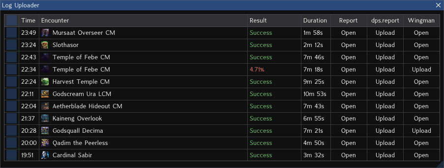
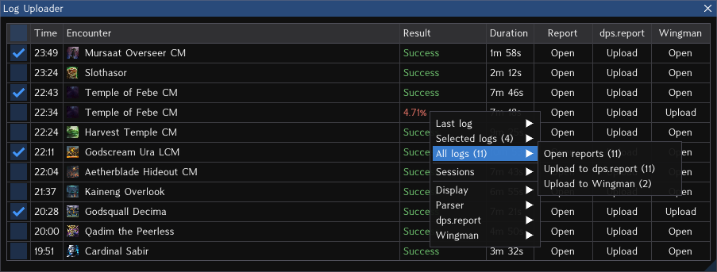
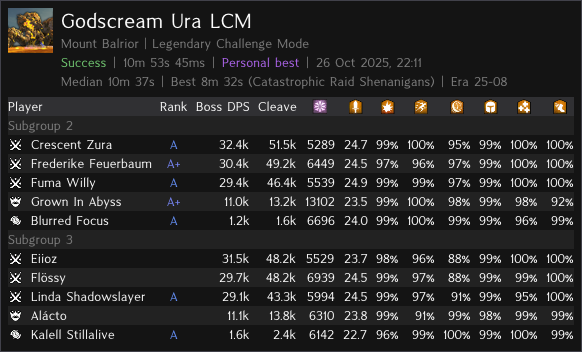
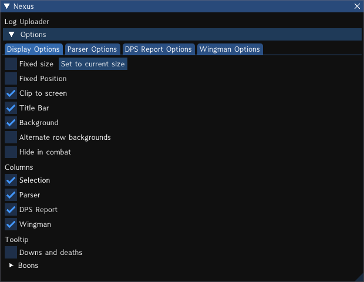
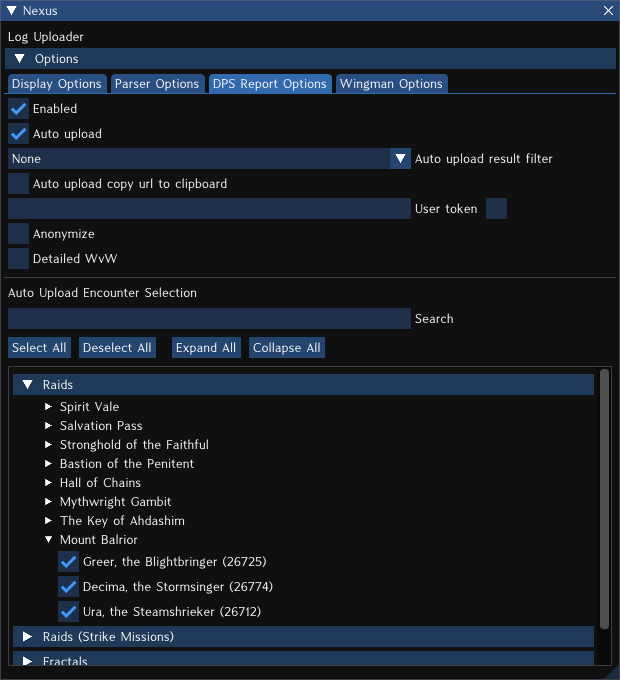

# Nexus Log Uploader

[Nexus](https://github.com/RaidcoreGG/Nexus) addon for Guild Wars 2 that parses your new arcdps logs locally with Elite Insights and uploads them to [dps.report](https://dps.report) or [Wingman](https://gw2wingman.nevermindcreations.de) if you want.



## Installation

Download `log_uploader.dll` from the [latest release](https://github.com/eioz/nexus-log-uploader/releases/latest) and put it in `<Guild Wars 2>\addons`. Nexus keeps it up to date. The addon installs Elite Insights itself.

## Features

### Logs table

New logs show up with their result and duration. The buttons open the Elite Insights report and upload to dps.report or Wingman, or open the log there once it is uploaded.

Right-click for actions on the last, the selected or all logs, like copying the dps.report links as a list or as markdown links. The sessions and settings are in the same menu.



### Encounter tooltip

Hover an encounter to see the squad by subgroup with boss DPS, cleave, CC and boons.

For bosses Wingman knows, the tooltip compares a kill with the other kills of its patch: how many kills it beat, the median and fastest kill, and your personal best. Players with a Wingman rank show it. Once the log is on Wingman, the tooltip also shows each player's DPS percentile, plus the support percentile for supports.



### Sessions

After the game starts, the first log begins a new session. **Resume last session** in the empty table continues the previous one instead, and **Sessions > New session** in the context menu starts a new one with the next log. Earlier sessions open from the same menu.

Archiving a session removes its Elite Insights reports but keeps the summaries and links. Its logs can be parsed again as long as their arcdps files exist. Archived sessions can be unarchived or deleted. Your arcdps logs are never deleted.

### Settings

dps.report and Wingman can each upload new logs of the encounters you pick, optionally only kills, and dps.report can copy the link to the clipboard. The display options pick the columns and the tooltip boons, and can add downs and deaths to the tooltip.

The settings are in the Nexus options and in the context menu.




## Building

**Prerequisites:** Visual Studio 2022 with C++ workload, [vcpkg](https://github.com/microsoft/vcpkg) installed and integrated (`vcpkg integrate install`).

```powershell
git clone --recurse-submodules https://github.com/eioz/nexus-log-uploader.git
cd nexus-log-uploader

.\build.ps1                # Release x64
.\build.ps1 -Config Debug  # Debug x64
.\build.ps1 -Rebuild       # Clean + rebuild
.\build.ps1 -Clean         # Remove build artifacts
.\build.ps1 -Mock          # Build and launch in nexus-mock
```

Output: `build\x64\Release\log_uploader.dll`

## Credits

The bundled icons are from the [Guild Wars 2 Wiki](https://wiki.guildwars2.com), the Guild Wars 2 render service and [Elite Insights](https://github.com/baaron4/GW2-Elite-Insights-Parser).

© ArenaNet LLC. All rights reserved. NCSOFT, ArenaNet, Guild Wars, Guild Wars 2, GW2, Heart of Thorns, Path of Fire, End of Dragons, Secrets of the Obscure, Janthir Wilds, Visions of Eternity, and all associated logos, designs, and composite marks are trademarks or registered trademarks of NCSOFT Corporation. All other trademarks are the property of their respective owners.
