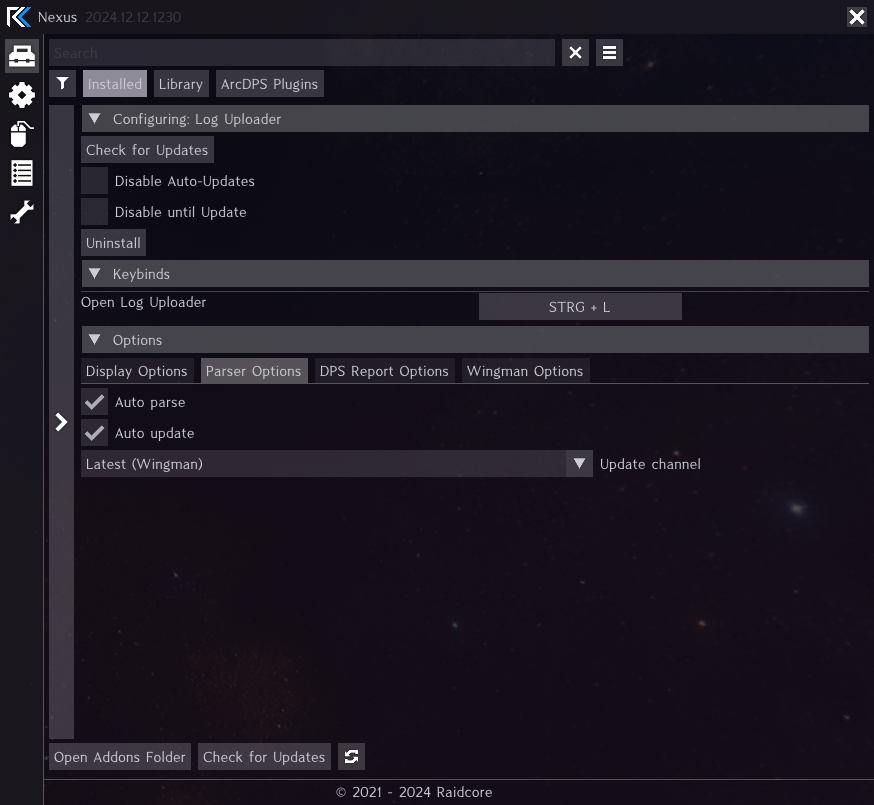
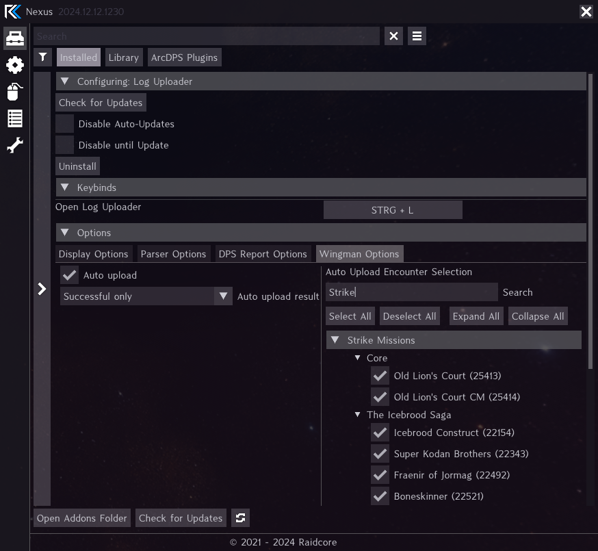

# Nexus Log Uploader

[Nexus](https://github.com/RaidcoreGG/Nexus) addon to automatically parse new arcdps logs locally and optionally upload them to [dps.report](https://dps.report) or [Wingman](https://gw2wingman.nevermindcreations.de).

## Features

- **Sessions:** logs are grouped into sessions. A log more than two hours after the previous one starts a new session, and **Sessions > New session** in the context menu starts one with the next log. Earlier sessions can be opened from the same menu.
- **Archiving:** archiving a session deletes its Elite Insights reports but keeps the summaries and links. A log can be parsed again as long as its arcdps file exists. Archived sessions can be unarchived or deleted. Your arcdps logs are never deleted.
- **Encounter tooltip:** hover an encounter name to see the squad with boss DPS, cleave, CC and boons. The display options choose the boons and whether to show downs and deaths.
- **Wingman statistics:** the tooltip compares a kill with the other kills of its patch on Wingman: its speed percentile, the median and fastest kill, and your personal best. Players with a Wingman rank show it. Once the log is on Wingman, the Wingman button opens its report and the tooltip adds each player's DPS percentile, plus the support percentile for supports.

## Screenshots






## Building

**Prerequisites:** Visual Studio 2022 with C++ workload, [vcpkg](https://github.com/microsoft/vcpkg) installed and integrated (`vcpkg integrate install`).

```powershell
git clone --recurse-submodules https://github.com/eioz/nexus-log-uploader.git
cd nexus-log-uploader

.\build.ps1                # Release x64
.\build.ps1 -Config Debug  # Debug x64
.\build.ps1 -Rebuild       # Clean + rebuild
.\build.ps1 -Clean         # Remove build artifacts
.\build.ps1 -Mock          # Build and launch in nexus-mock
```

Output: `build\x64\Release\log_uploader.dll`

## Credits

The bundled icons are from the [Guild Wars 2 Wiki](https://wiki.guildwars2.com), the Guild Wars 2 render service and [Elite Insights](https://github.com/baaron4/GW2-Elite-Insights-Parser).

© ArenaNet LLC. All rights reserved. NCSOFT, ArenaNet, Guild Wars, Guild Wars 2, GW2, Heart of Thorns, Path of Fire, End of Dragons, Secrets of the Obscure, Janthir Wilds, Visions of Eternity, and all associated logos, designs, and composite marks are trademarks or registered trademarks of NCSOFT Corporation. All other trademarks are the property of their respective owners.
